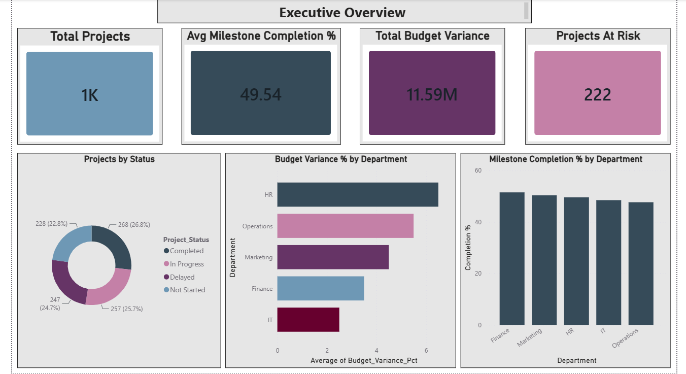
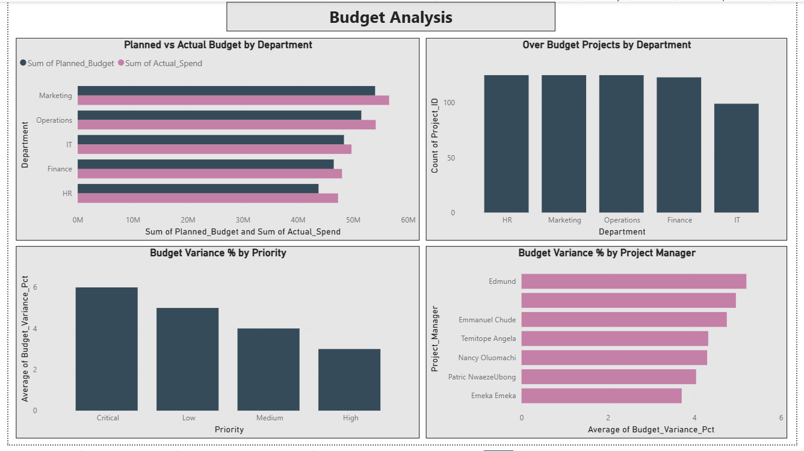
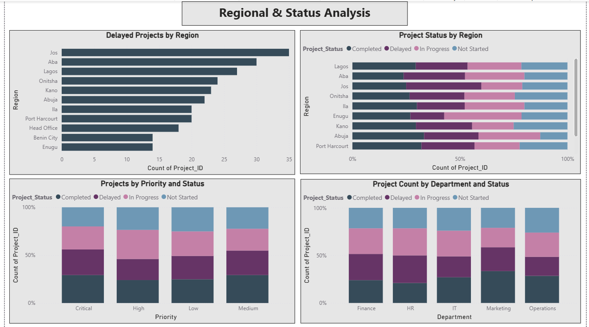
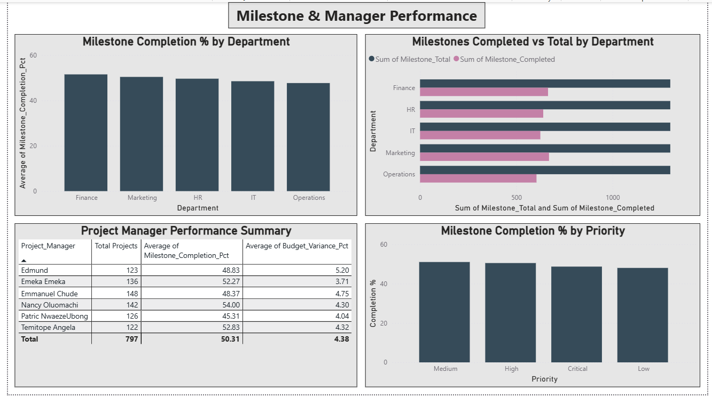

# Project Portfolio Dashboard

**If you're responsible for 1,000 projects, how do you see which ones are slipping before the quarter ends?**

A PMO-style dashboard in Power BI: budget, milestones, regions and project managers, all on four pages. The cleaning and enrichment were done in Power Query, and every number was checked again in SQL.

**Tools:** Excel + Power Query · SQL (SQLite) · Power BI

> **Honest note on the data:** the projects, dates, status and regions come from a public Kaggle dataset. Budgets, departments, priorities and milestones were not in it, so I generated them in Power Query (method below). The findings show what the dashboard can surface. They aren't facts about a real company.



---

## What the dashboard shows

- **The portfolio is 4.75% over budget overall:** €11.59M over a planned €244M.
- **222 projects (22%) are at risk,** meaning delayed, or in progress with under half their milestones done.
- **203 projects have no project manager.** That's the cheapest problem to fix.
- **Critical-priority projects overrun as much as low-priority ones,** so a "critical" label doesn't protect a budget.
- **HR has the highest budget variance (8.1%)** and IT the lowest (2.83%). Operations is weak on both budget and milestones (46.54% complete).
- **Jos and Aba have the most delayed projects;** Enugu and Benin City deliver most reliably.

## What I'd do with it

1. **Give the 203 unowned projects an owner first.**
2. **Treat "critical" as a budget risk too:** add a budget checkpoint when a project is escalated.
3. **Review HR's largest active projects** for cost control.
4. **Look for a shared cause in Jos and Aba** (staffing, approvals, suppliers) before adding more work there.
5. **Pilot combined budget-and-milestone tracking in Operations,** where both are weakest.

## The questions

| # | Question |
|---|---|
| 1 | Are projects on time and on budget? |
| 2 | Which departments are over budget, and by how much? |
| 3 | Which regions have the most delays? |
| 4 | How many projects are at risk? |
| 5 | Which project managers deliver best, and who needs support? |
| 6 | Where would a fix make the biggest difference? |

---

## Dataset

| Attribute | Detail |
|---|---|
| **Source** | [Kaggle — Project Management Dataset](https://www.kaggle.com/datasets/derrickkuria/project-management) |
| **Size** | 1,000 project records |
| **Format** | CSV |

**Original Columns (from Kaggle):**

| Column | Description |
|---|---|
| `id` | Unique project identifier |
| `Company` | Project/company name |
| `Site Name` | Delivery region |
| `EntryDate` | Project start date |
| `WorkStatus` | Project status (In Progress, Completed, Not Started, Stopped) |
| `CompleteDate` | Actual completion date |
| `ReccuringRevenue` | Recurring revenue figure |
| `NRR` | Net revenue retention figure |
| `Task Owner` | Assigned project manager |
| `Currency` | Project currency |

**Data Enrichment & Methodology**

The source dataset provided project identity, dates, and status — but no budget, milestone, or department-level detail, which a PMO dashboard requires. The following fields were **synthetically generated** using Power Query, derived from existing fields to keep results internally consistent:

| Field | How it was generated |
|---|---|
| `Department` | Assigned via formula across 5 departments |
| `Priority` | Assigned via formula across 4 priority levels |
| `Planned_End_Date` | Calculated from Start_Date + randomized duration |
| `Actual_Spend` | Derived from Planned_Budget ± randomized variance |
| `Budget_Variance` / `Budget_Variance_Pct` | Calculated from Planned_Budget vs Actual_Spend |
| `Milestone_Total` / `Milestone_Completed` | Assigned via formula to simulate milestone tracking |
| `Milestone_Completion_Pct` | Calculated from milestone fields above |

All department names, priorities, and performance figures are synthetic and used for demonstration purposes only — they do not reflect real companies or individuals.

**Note:** `Delay_Days` was excluded from final analysis due to inconsistent date formats in the source data. Timeline risk is assessed via `Project_Status` instead.

---

## Tools & Technologies

| Tool | Purpose |
|---|---|
| **Microsoft Excel + Power Query** | Data cleaning, enrichment, mixed-date-format resolution |
| **SQL (SQLite / DB Browser)** | Business-question validation, exploratory analysis |
| **Power BI Desktop** | Interactive 4-page dashboard |

---

## Project Structure

```
project-portfolio-performance-dashboard/
├── data/
│   └── project_portfolio_clean.csv
├── sql/
│   └── sql_queries.sql
├── dashboard/
│   └── project_portfolio_dashboard.pbix
├── screenshots/
│   ├── executive_overview.png
│   ├── budget_analysis.png
│   ├── regional_status_analysis.png
│   └── milestone_manager_performance.png
└── README.md
```

---

## Dashboard Overview

The dashboard is structured across four analytical pages:

**Page 1 — Executive Overview**
High-level KPIs for senior management: total projects, average milestone completion, total budget variance, and projects at risk. Includes a status breakdown and budget/milestone comparison by department.

**Page 2 — Budget Analysis**
Drill-down into where money is being lost. Planned vs. actual spend by department, budget variance by priority level, and variance by project manager.

**Page 3 — Regional & Status Analysis**
Where delivery is breaking down geographically. Delayed projects by region, status distribution across regions, and status breakdown by priority and department.

**Page 4 — Milestone & Manager Performance**
Who is delivering, and who needs support. Milestone completion by department, completed vs. total milestones, and a full project manager performance summary table.

---

## Screenshots

### Budget Analysis


### Regional & Status Analysis


### Milestone & Manager Performance


---

## SQL Analysis

Business questions validated using SQL in DB Browser for SQLite.
Full queries available in [`sql/sql_queries.sql`](sql/sql_queries.sql)

Key analyses:
- Portfolio budget variance by department
- Projects at risk identification
- Regional delay analysis
- Project manager performance comparison
- Milestone completion rates

---

---

Made by **Vigneshwari Nalla (Vee)** · MSc Data Analytics for Business, KEDGE Business School
[website](https://vigneshwari2408.github.io/vigneshwari-portfolio/) · [linkedin](https://www.linkedin.com/in/vigna24/) · [all projects](https://github.com/vigneshwari2408)
